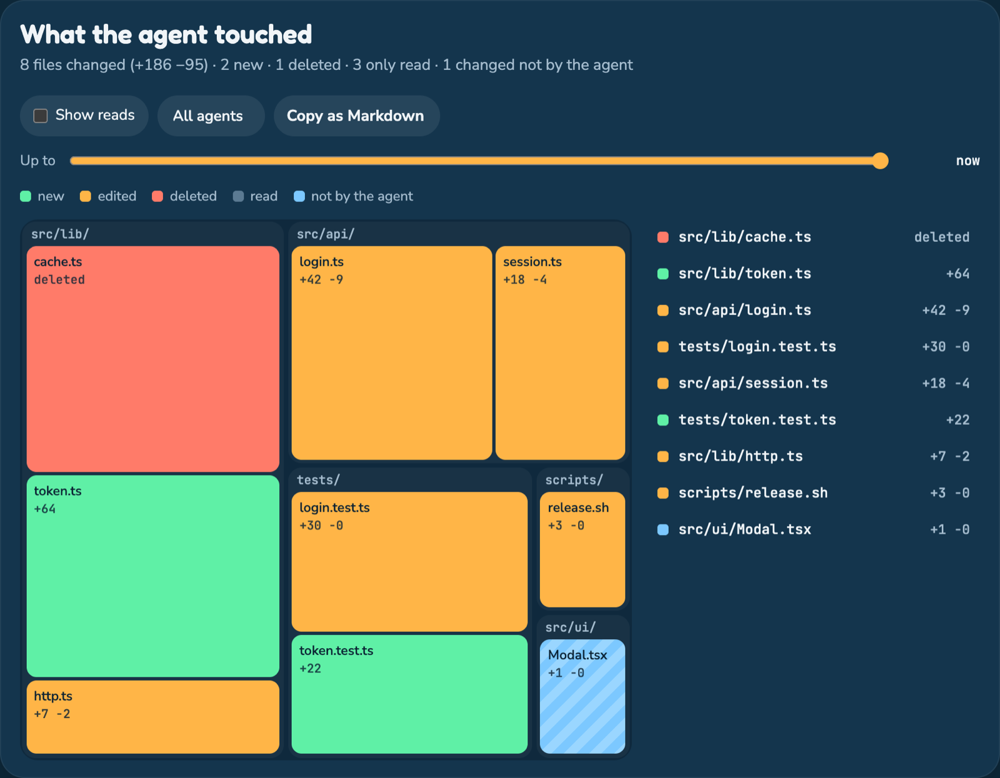

# Agent Theatre

**Watch your coding agent work — as a film, not a log.**

Agent Theatre turns a Claude Code session into an animated scene. Your repo becomes a stage:
folders are districts, files are buildings, test files are beacons. The agent is a character —
one of a cast of twelve — who walks to the files it reads, builds on the files it edits, runs
tests at the beacons, and chases bug gremlins when they fail. Subagents arrive at the dock as
other members of the cast. Live, or replayed from any past session.

**Twenty-one stages.** Agent Theatre reads what your repo is — a web app, a backend, a CLI, data
work, a game, infrastructure — and suggests the stages that suit it: Island, Orbit, Metropolis,
Harbour, Observatory, Greenhouse, Workshop, Arcade, Kingdom, Outpost, Snowfield, Canopy,
Lagoon, Volcano, Cloudtop, Reef, Bazaar, Monastery, Moonbase, Lanterns — and, in the weeks
around Halloween, Halloween: jack-o'-lanterns, bats, a ghost-white gremlin and the odd jump scare (switch them
off with *Scares* in the toolbar). Or hit *Surprise me*.

And one honest detail no other visualiser has: **if the agent says the job is done but no test
has passed since the last edit, a gremlin hides behind it.**


### What did the agent change?

The **Changes** view turns the same session into a map of every file the agent touched: folders as blocks, files sized by
lines changed and coloured by what happened (new, edited, deleted, read), plus anything changed during the session that
the agent did *not* do (you, a formatter, another tool). Drag the time slider to see the map at any moment, filter to one
helper, click a file for its diff, or copy the whole thing as Markdown for a pull request.



- **At the end of every turn**, Claude Code shows a one-line summary under the reply, e.g. `this turn: 3 files changed (+50 −2) · 1 new · 1 deleted` with a link to the map. Turn it off with `AGENT_THEATRE_SUMMARY=0`.
- **In the terminal:** `npx agent-theatre changes` (`--md` for Markdown, `--json`, `--reads`).
- **On the pull request:** `npx agent-theatre changes --pr` posts (or updates) one comment with the map, using your own `gh` login, after asking you.
- **In VS Code:** an **Agent changes** list in the Explorer, a dot on every file the agent touched, and the editor's own diff on click.

Built from the agent's own events and checked against git, so shell edits (`sed -i`, heredocs, `rm`) are confirmed on disk
before they appear, and changes committed mid-session still count. Paths and line counts only; a diff is read from your
disk only when you open it.

| | | |
|---|---|---|
|  |  |  |
|  |  |  |

*Same session, different stages, different leads. The picker reads your repo and suggests three.*

**Six bundled episodes**, each a different kind of work in a different repo — all synthetic, hand-written, never a captured session:

| Episode | Kind | What happens |
|---|---|---|
| The login timeout | bug fix | two failing tests, one grace window, a green run — and the evidence chip |
| The research brief | research | field notes, a data file, two web searches, one written brief; no tests claimed |
| The export endpoint | new feature | two new buildings rise, a route is wired, the suite is green first time |
| The rename | refactor | six files touched, one test catches a slip, fifty-eight pass |
| Ship 1.4.0 | deploy | all shell work at the forge: build, plan, a timeout, a retry, a rollout, a tag |
| The audit | helpers | two helpers arrive at the dock and fan out while the lead keeps working |

Watch them at [agenttheatre.dev](https://agenttheatre.dev) or locally with `?demo=research`, `?demo=feature`, `?demo=refactor`, `?demo=deploy`, `?demo=subagents`.

## Status

**v1.6.0** — the **Changes** map; on npm as [`agent-theatre`](https://www.npmjs.com/package/agent-theatre), VS Code extension on every
[release](https://github.com/shreyassaw5394/agent-theatre/releases), six playable episodes at
[agenttheatre.dev](https://agenttheatre.dev). Live via hooks and replay of real sessions both verified
end-to-end on real repos. Design notes in [docs/design.md](docs/design.md).

## Install

Pick whichever fits how you work. All of them run the same local stage; nothing leaves your machine.

| Where | How | Notes |
|---|---|---|
| **npm (CLI)** | `npx agent-theatre` | Node 22+. `npx agent-theatre replay` for past sessions |
| **Claude Code plugin** | `/plugin install agent-theatre --marketplace shreyassaw5394/agent-theatre` | one step on Claude Code 2.1.275+; brings the hooks, a `/theatre` command and a skill |
| **Homebrew** | `brew install shreyassaw5394/tap/agent-theatre` | tap: [shreyassaw5394/homebrew-tap](https://github.com/shreyassaw5394/homebrew-tap) |
| **VS Code** | search **Agent Theatre** in Extensions, or [Marketplace](https://marketplace.visualstudio.com/items?itemName=agenttheatre.agent-theatre-vscode) | commands: *Open the stage (live)*, *Replay a session…*, *Switch folder*. `.vsix` also on every [release](https://github.com/shreyassaw5394/agent-theatre/releases/latest) |
| **Cursor / Windsurf / VSCodium** | `agent-theatre.vsix` from the [latest release](https://github.com/shreyassaw5394/agent-theatre/releases/latest) → *Extensions → ⋯ → Install from VSIX…* | same extension; Open VSX listing coming |
| **MCP server** (Cursor, Windsurf, Claude Desktop, Codex, Gemini CLI, VS Code Copilot) | `npx agent-theatre init` | registers `agent-theatre serve` with every agent on your machine; `--repo` writes `.mcp.json` / `.cursor/mcp.json` / `.vscode/mcp.json` for the team. One-click: [](https://cursor.com/en/install-mcp?name=agent-theatre&config=eyJjb21tYW5kIjoibnB4IiwiYXJncyI6WyIteSIsImFnZW50LXRoZWF0cmVAbGF0ZXN0Iiwic2VydmUiXX0=) [](https://vscode.dev/redirect/mcp/install?name=agent-theatre&config=%7B%22name%22%3A%22agent-theatre%22%2C%22command%22%3A%22npx%22%2C%22args%22%3A%5B%22-y%22%2C%22agent-theatre%40latest%22%2C%22serve%22%5D%7D) |
| **Just watch** | [agenttheatre.dev](https://agenttheatre.dev) | six synthetic episodes, no install |

**First run (CLI):**

```sh
cd your-repo
npx agent-theatre hooks install   # once — skip if you installed the Claude Code plugin, it brings the hooks
npx agent-theatre                 # opens the stage for this repo; run Claude Code in another terminal
npx agent-theatre replay          # pick any past Claude Code session of this repo and watch it
npx agent-theatre changes         # what the agent touched: files, lines, new, deleted (--md, --pr)
npx agent-theatre hooks uninstall # reverses the install byte-for-byte
```

Flags: `--port <n>`, `--no-open`, `--set <stage-id>`; `replay --latest` skips the picker. Global install if you prefer: `npm i -g agent-theatre`.

**In the stage:** hover anything for what it is and what happened to it this session. Live stages show **Live** at the edge and a **Go live** button whenever you have scrubbed back. **Whole repo** pulls back to every building (wheel to zoom). **Full screen** (or `F`) keeps just the stage and the transport bar. **Export clip** records what you see and hear to mp4/webm with a share sheet (download, system share, X, LinkedIn). When the agent needs you, the stage says so and points you back to Claude Code (in VS Code it focuses the Claude Code input); you answer there, never on the stage. When the agent goes quiet the stage says so: after ~20 s "thinking…", after 90 s the house lights dim, the lead sits down, ambience thins and a banner counts the silence; the moment an event arrives it all comes back. When the session ends, the banner says so. A stage watches the folder it was started in; several stages at once (browser, VS Code, another repo) all receive events.

## MCP tools

`agent-theatre serve` is an MCP server (stdio). Any MCP client can:

| Tool | Does |
|---|---|
| `open_stage` | start (or reuse) the live stage for a folder → URL |
| `list_sessions` | past Claude Code sessions of a folder: ids, titles, times |
| `replay_session` | open a replay of one session (newest by default) → URL |
| `stage_status` | event/beat counts and the last few event kinds; never contents |
| `what_changed` | the change map: files read, edited, created, deleted, with line counts; Markdown for a PR on request |
| `install_hooks` | install the Claude Code hooks (not needed with the plugin) |

Listed on the [MCP Registry](https://registry.modelcontextprotocol.io) as `io.github.shreyassaw5394/agent-theatre`.

## How it works

```
Claude Code ──hooks──▶ agent-theatre (local) ──WebSocket──▶ browser / VS Code webview
     │                        │
     └─ JSONL transcript ─────┘  (replay)
```

1. **Events.** Hook payloads (live) or transcript rows (replay) are normalised into a small,
   product-agnostic `AgentEvent` schema: `read_file`, `edit_file (+n −m)`, `run_command
   (intent)`, `test_result`, `subagent_start/stop`, `waiting_for_user`, `turn_end`, …
2. **Stage.** The repo's file tree becomes a deterministic arrangement — one of six layout
   archetypes (ring, grid, strip, scatter, terrace, spine) chosen from the repo and the stage,
   so the same project is a ring island in one set and a terraced spine in another, and always
   the same in the same set. Capped to ~60 buildings by relevance; every file the session
   touches is always placed.
3. **Director.** Events become scene beats — `walk_to`, `build`, `run_tests`, `spawn_gremlin`,
   `chase`, `celebrate`, `unverified_claim` — with a mood: curious, focused, lost, happy.
4. **Renderer.** PixiJS, isometric, soft lighting, easing everywhere — no linear tween exists
   in the codebase, a test makes sure. The camera frames the action; the whole stage appears
   only to open, celebrate and close, so it never gets cluttered. One key light: long soft
   cast shadows, gradient faces with ambient occlusion and rim light, aerial haze on far rows,
   bloom only on lamps and lit windows, cloud shadows drifting over the ground.
   `prefers-reduced-motion` respected. Twenty-one stages, each with its own silhouette — gabled
   harbour houses, pagoda tiers, onion domes, moonbase capsules, bazaar tents — on the same
   geometry; a cast of twelve characters from one procedural routine.
5. **Sound.** Every beat has a sound, all synthesized at runtime with the Web Audio API — no
   audio files, no licences to worry about. Every stage has its own voice (waveform, pitch,
   decay, the surface underfoot) and its own ambience — washes, pads and occasional details
   like gulls, bells, bubbles, wind or market murmur on a jittered timer, so nothing loops.
   Effects and background ambience toggle separately.
   The "needs your permission" chime is the one you'll notice.

## Privacy

Everything stays on your machine. The event stream never contains code, prompts, command text
or search queries — only repo-relative paths, counts, a command's first word and a classified
intent. This is a tested invariant (`packages/core/tests/privacy.test.ts` plants secrets in a
fixture session and asserts none reach the stream).

| | Read | Rendered | Leaves the machine |
|---|---|---|---|
| File paths | yes | repo-relative | never |
| File contents | counted only (±lines) | only a file's diff, when you open it in the Changes view (read from your disk) | never |
| Your prompts | tail never read; never stored | no | never |
| The agent's closing message | last paragraph, truncated to 240 chars (`turn_end.note`) | yes — shown with "your turn" so you know what it asked | never |
| Command text | first word + classified intent + redirect / delete targets | no | never |
| End-of-turn summary | file paths and line counts of the turn | shown by Claude Code under the reply | never |
| PR comment (`changes --pr`) | paths and line counts | posted only when you confirm, with your own `gh` login | to GitHub, by you |
| Test output | summary counts only | pass/fail | never |
| Telemetry | — | — | none, ever |
| Audio | — | synthesized, no files | never |

The server binds to `127.0.0.1` only. Hooks exit 0 and never block or slow your agent.

## Repo layout

`packages/core` (schema, adapters, island, director — no DOM, no fs) ·
`packages/cli` · `packages/web` · `packages/vscode` · `fixtures/` (synthetic sessions).

## Community

Questions, stages worth showing off, ideas for v2: **[Agent Theatre Discord](https://discord.gg/PPGeQWd7r)**. The whole suite (LastSearch, Debug Anything, Agent Theatre) also shares [one server](https://discord.gg/s8wj7tBAM).

## Site

**[agenttheatre.dev](https://agenttheatre.dev)** — the story, a playable Episode 1, all twenty-one stages, the cast,
the privacy sheet and install notes. `agenttheatre.com` redirects there. The site is `site/` in this
repo, deployed on Vercel from `main`; the playable demo is the real web bundle at `/theatre/`.

## License

MIT © 2026 Shreyas Sawant and Agent Theatre contributors.

---

Agent Theatre is a free, non-commercial passion project. MIT licensed; bundled third-party code is listed in `THIRD_PARTY_LICENSES.txt`. It runs locally and sends no telemetry ([privacy](https://agenttheatre.dev/privacy)).
