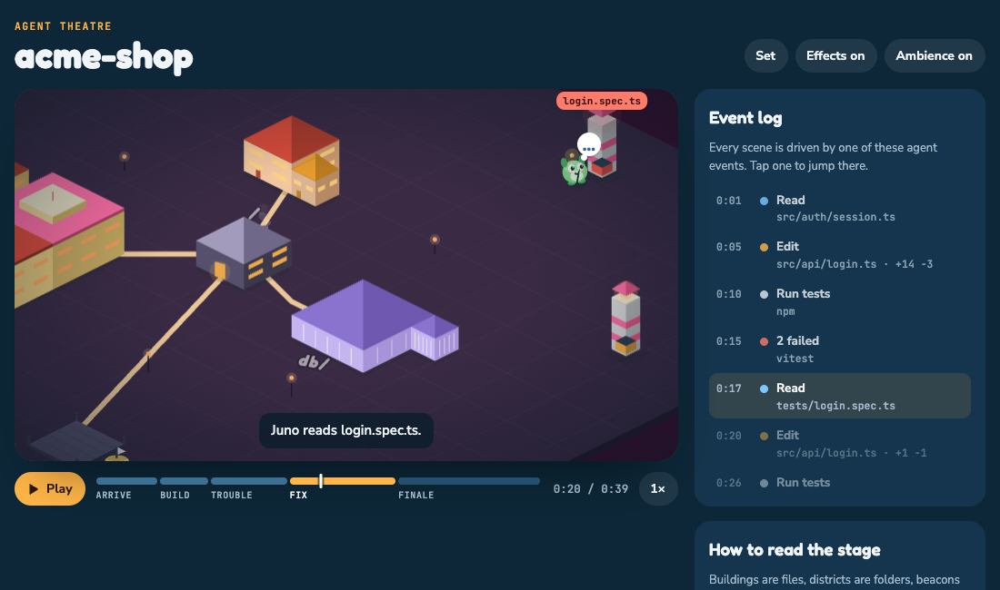
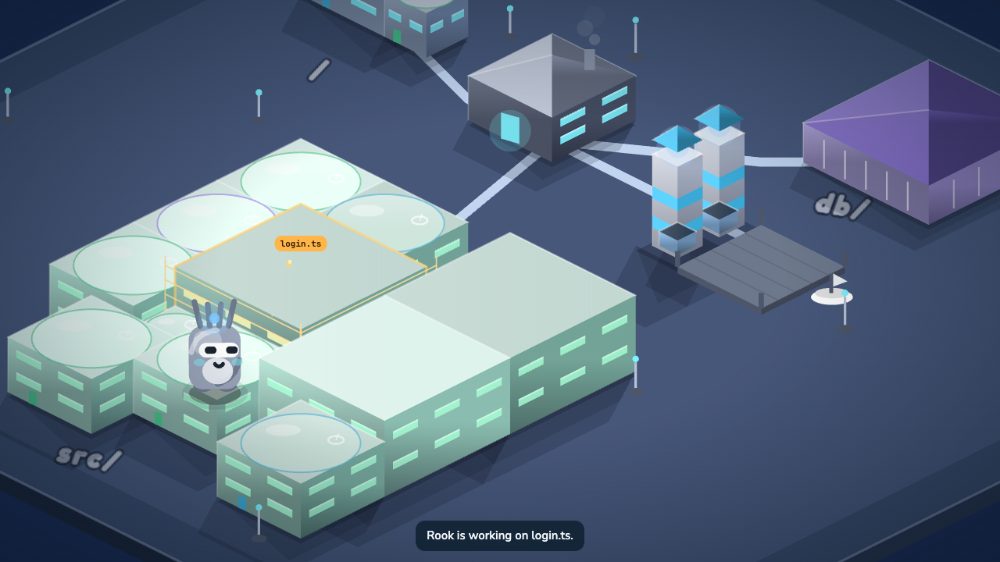
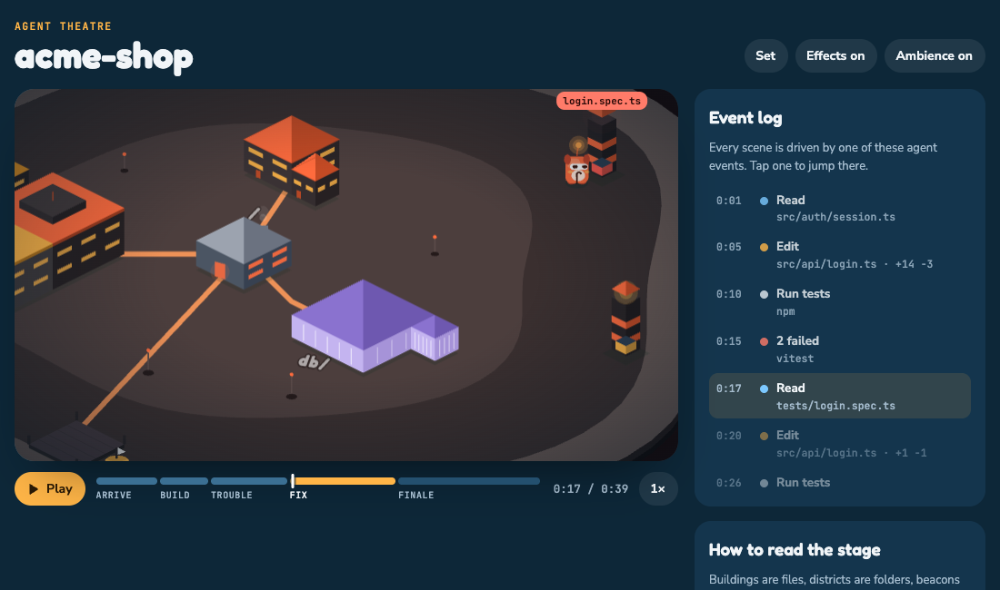
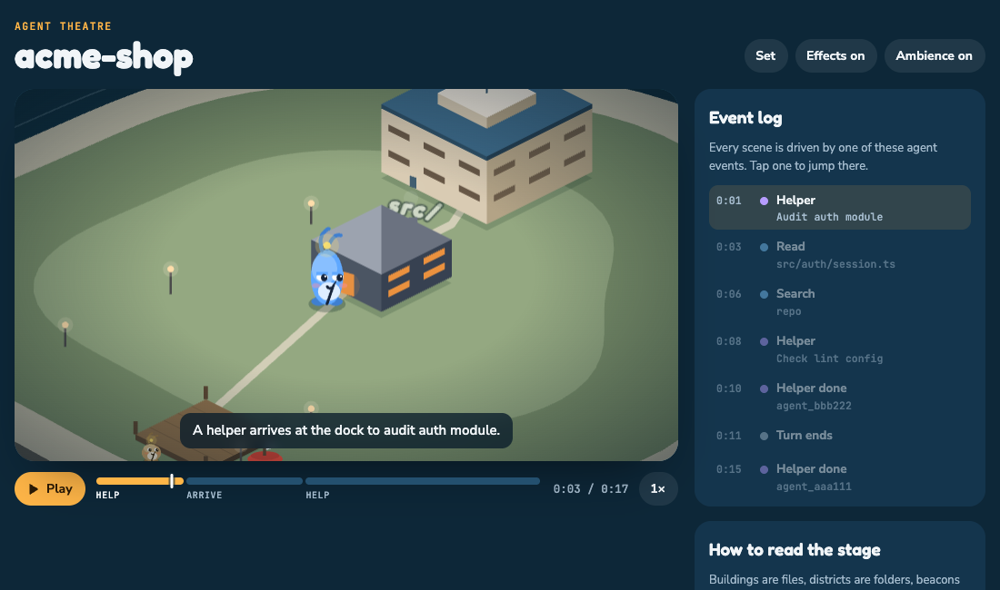
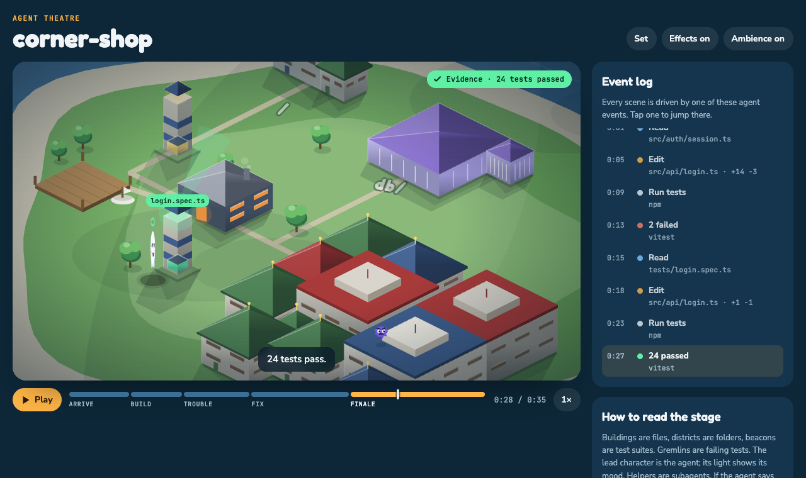
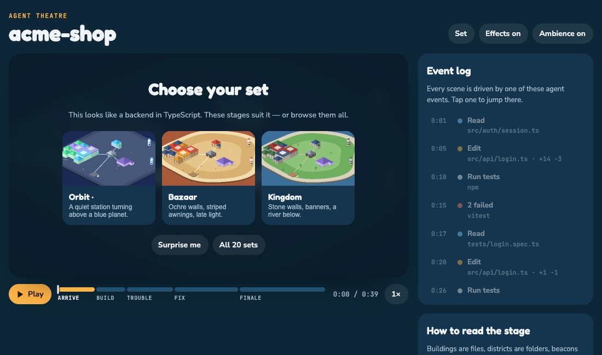

# Agent Theatre

**Watch your coding agent work — as a film, not a log.**

Agent Theatre turns a Claude Code session into an animated scene. Your repo becomes a stage:
folders are districts, files are buildings, test files are beacons. The agent is a character —
one of a cast of twelve — who walks to the files it reads, builds on the files it edits, runs
tests at the beacons, and chases bug gremlins when they fail. Subagents arrive at the dock as
other members of the cast. Live, or replayed from any past session.

**Twenty stages.** Agent Theatre reads what your repo is — a web app, a backend, a CLI, data
work, a game, infrastructure — and suggests the stages that suit it: Island, Orbit, Metropolis,
Harbour, Observatory, Greenhouse, Workshop, Arcade, Kingdom, Outpost, Snowfield, Canopy,
Lagoon, Volcano, Cloudtop, Reef, Bazaar, Monastery, Moonbase, Lanterns. Or hit *Surprise me*.

And one honest detail no other visualiser has: **if the agent says the job is done but no test
has passed since the last edit, a gremlin hides behind it.**



| | | |
|---|---|---|
|  |  |  |
|  |  |  |

*Same session, different stages, different leads. The picker reads your repo and suggests three.*

**Six bundled episodes**, each a different kind of work in a different repo — all synthetic, hand-written, never a captured session:

| Episode | Kind | What happens |
|---|---|---|
| The login timeout | bug fix | two failing tests, one grace window, a green run — and the evidence chip |
| The research brief | research | field notes, a data file, two web searches, one written brief; no tests claimed |
| The export endpoint | new feature | two new buildings rise, a route is wired, the suite is green first time |
| The rename | refactor | six files touched, one test catches a slip, fifty-eight pass |
| Ship 1.4.0 | deploy | all shell work at the forge: build, plan, a timeout, a retry, a rollout, a tag |
| The audit | helpers | two helpers arrive at the dock and fan out while the lead keeps working |

Watch them at [agenttheatre.dev](https://agenttheatre.dev) or locally with `?demo=research`, `?demo=feature`, `?demo=refactor`, `?demo=deploy`, `?demo=subagents`.

## Status

**v1.0.0** — on npm as [`agent-theatre`](https://www.npmjs.com/package/agent-theatre), VS Code extension on every
[release](https://github.com/shreyassaw5394/agent-theatre/releases), six playable episodes at
[agenttheatre.dev](https://agenttheatre.dev). Live via hooks and replay of real sessions both verified
end-to-end on real repos. Design notes in [docs/design.md](docs/design.md).

## Install

**CLI** (Node 22+ — works with the Claude Code CLI, desktop app and IDE extensions, anything that runs hooks):

```sh
cd your-repo
npx agent-theatre hooks install   # once: adds hooks to ~/.claude/settings.json, keeps a backup
npx agent-theatre                 # opens the stage for this repo; run Claude Code in another terminal
npx agent-theatre replay          # pick any past Claude Code session of this repo and watch it
npx agent-theatre hooks uninstall # reverses the install byte-for-byte
```

Flags: `--port <n>`, `--no-open`, `--set <stage-id>`; `replay --latest` skips the picker.

In the stage: hover anything for what it is and what happened to it this session; live stages show **Live** at the edge and a **Go live** button whenever you have scrubbed back; **Whole repo** pulls back to every building (wheel to zoom), **Export clip** records what you see and hear to a `.webm` you can post. When the agent needs you, the stage says so and points you back to Claude Code (in VS Code it focuses the Claude Code input); you answer there, never on the stage. Install globally if you prefer: `npm i -g agent-theatre`.

**Claude Code plugin** (hooks + a `/theatre` command + a skill, one step on Claude Code 2.1.275+):

```
/plugin install agent-theatre --marketplace shreyassaw5394/agent-theatre
```

**Homebrew**: `brew install shreyassaw5394/tap/agent-theatre`

**VS Code**: download `agent-theatre.vsix` from the [latest release](https://github.com/shreyassaw5394/agent-theatre/releases/latest), then *Extensions → ⋯ → Install from VSIX…* (or `code --install-extension agent-theatre.vsix`). Commands: *Agent Theatre: Open the stage (live)*, *Replay a session…*, *Install hooks*. Marketplace listing is coming.

**Just watch**: [agenttheatre.dev](https://agenttheatre.dev) plays six synthetic episodes in the browser, no install.

## How it works

```
Claude Code ──hooks──▶ agent-theatre (local) ──WebSocket──▶ browser / VS Code webview
     │                        │
     └─ JSONL transcript ─────┘  (replay)
```

1. **Events.** Hook payloads (live) or transcript rows (replay) are normalised into a small,
   product-agnostic `AgentEvent` schema: `read_file`, `edit_file (+n −m)`, `run_command
   (intent)`, `test_result`, `subagent_start/stop`, `waiting_for_user`, `turn_end`, …
2. **Stage.** The repo's file tree becomes a deterministic arrangement — one of six layout
   archetypes (ring, grid, strip, scatter, terrace, spine) chosen from the repo and the stage,
   so the same project is a ring island in one set and a terraced spine in another, and always
   the same in the same set. Capped to ~60 buildings by relevance; every file the session
   touches is always placed.
3. **Director.** Events become scene beats — `walk_to`, `build`, `run_tests`, `spawn_gremlin`,
   `chase`, `celebrate`, `unverified_claim` — with a mood: curious, focused, lost, happy.
4. **Renderer.** PixiJS, isometric, soft lighting, easing everywhere — no linear tween exists
   in the codebase, a test makes sure. The camera frames the action; the whole stage appears
   only to open, celebrate and close, so it never gets cluttered. One key light: long soft
   cast shadows, gradient faces with ambient occlusion and rim light, aerial haze on far rows,
   bloom only on lamps and lit windows, cloud shadows drifting over the ground.
   `prefers-reduced-motion` respected. Twenty stages, each with its own silhouette — gabled
   harbour houses, pagoda tiers, onion domes, moonbase capsules, bazaar tents — on the same
   geometry; a cast of twelve characters from one procedural routine.
5. **Sound.** Every beat has a sound, all synthesized at runtime with the Web Audio API — no
   audio files, no licences to worry about. Every stage has its own voice (waveform, pitch,
   decay, the surface underfoot) and its own ambience — washes, pads and occasional details
   like gulls, bells, bubbles, wind or market murmur on a jittered timer, so nothing loops.
   Effects and background ambience toggle separately.
   The "needs your permission" chime is the one you'll notice.

## Privacy

Everything stays on your machine. The event stream never contains code, prompts, command text
or search queries — only repo-relative paths, counts, a command's first word and a classified
intent. This is a tested invariant (`packages/core/tests/privacy.test.ts` plants secrets in a
fixture session and asserts none reach the stream).

| | Read | Rendered | Leaves the machine |
|---|---|---|---|
| File paths | yes | repo-relative | never |
| File contents | counted only (±lines) | no | never |
| Your prompts | tail never read; never stored | no | never |
| The agent's closing message | last paragraph, truncated to 240 chars (`turn_end.note`) | yes — shown with "your turn" so you know what it asked | never |
| Command text | first word + classified intent + redirect targets | no | never |
| Test output | summary counts only | pass/fail | never |
| Telemetry | — | — | none, ever |
| Audio | — | synthesized, no files | never |

The server binds to `127.0.0.1` only. Hooks exit 0 and never block or slow your agent.

## Repo layout

`packages/core` (schema, adapters, island, director — no DOM, no fs) ·
`packages/cli` · `packages/web` · `packages/vscode` · `fixtures/` (synthetic sessions).

## Community

Questions, stages worth showing off, ideas for v2: **[Agent Theatre Discord](https://discord.gg/PPGeQWd7r)**. The whole suite (LastSearch, Debug Anything, Agent Theatre) also shares [one server](https://discord.gg/s8wj7tBAM).

## Site

**[agenttheatre.dev](https://agenttheatre.dev)** — the story, a playable Episode 1, all twenty stages, the cast,
the privacy sheet and install notes. `agenttheatre.com` redirects there. The site is `site/` in this
repo, deployed on Vercel from `main`; the playable demo is the real web bundle at `/theatre/`.

## License

MIT © 2026 Shreyas Sawant and Agent Theatre contributors.
